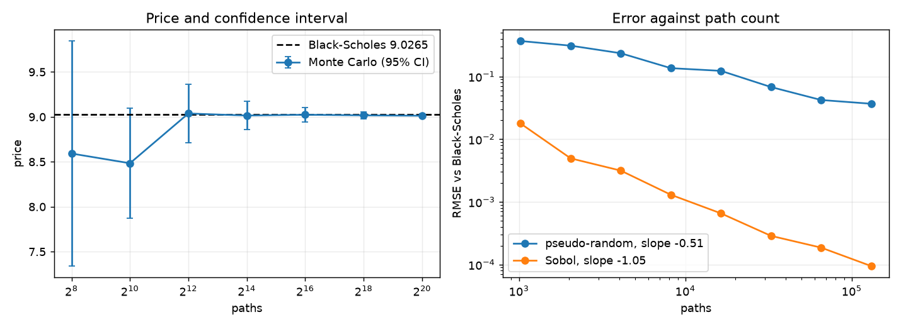
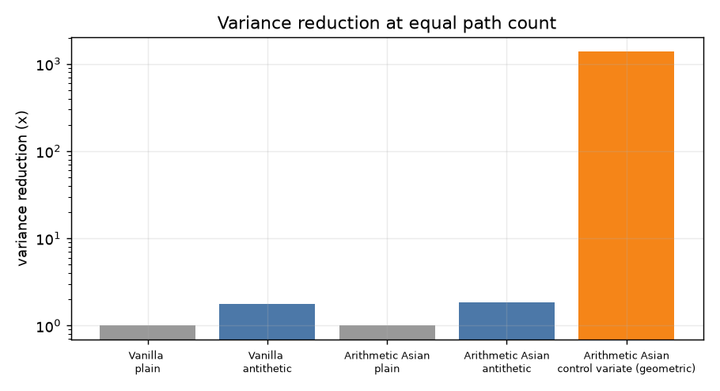
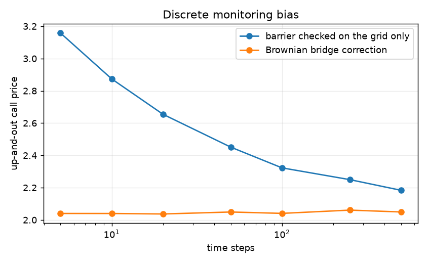
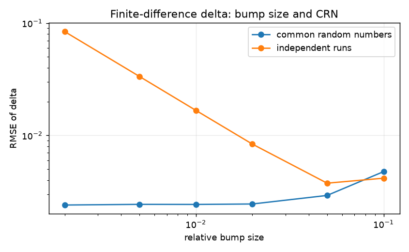

# options-pricer

[](https://github.com/neelayyagar1/options-pricer/actions/workflows/ci.yml)

A Python package for pricing options three ways: the Black-Scholes-Merton closed form, Monte Carlo simulation, and a binomial tree. The closed form is the reference, and the Monte Carlo engine is checked against it, so any disagreement shows up as a failing test instead of a plausible-looking number.

What is covered:

- European options by closed form, with all five Greeks derived analytically
- European, Asian (arithmetic and geometric) and barrier options by Monte Carlo
- American options by Longstaff-Schwartz least squares Monte Carlo, checked against a binomial tree
- Variance reduction (antithetic variates, control variates), with the reduction measured
- Greeks from the simulation two ways (finite difference and pathwise), compared with the analytic values

Everything is seeded and the figures below regenerate with `python examples/run_all.py`.

## The idea in plain language

**What is an option worth?** A call pays `max(S_T - K, 0)` at expiry. The hard part is that nobody knows `S_T`, so the question is how to put a fair price today on a payoff that depends on a random future price.

**Why risk-neutral pricing works.** Suppose you sell the option and hold some shares of the stock against it. If you adjust the number of shares continuously, the random part of the option and the random part of the shares cancel, and what is left has no risk. A position with no risk has to earn the risk-free rate, or someone could borrow cheaply and lock in free profit. That requirement pins down the price. Notice what it never used: how much the stock is expected to grow, or how much anyone dislikes risk. Both drop out. So we are free to compute the price in a simplified world where every asset grows at the risk-free rate on average. This does not claim investors are indifferent to risk. It is a calculation device that gives the same price as the no-arbitrage argument.

**The PDE.** Writing the argument above in math gives the Black-Scholes equation for the option value $V(S, t)$:

$$\frac{\partial V}{\partial t} + \frac{1}{2}\sigma^2 S^2 \frac{\partial^2 V}{\partial S^2} + (r - q) S \frac{\partial V}{\partial S} - rV = 0$$

Read it as bookkeeping for the hedged position: time decay, the cost of curvature in the payoff, and the carry on the hedge have to add up to the risk-free return. For a call it has the closed-form solution

$$C = S e^{-qT} N(d_1) - K e^{-rT} N(d_2), \qquad d_{1,2} = \frac{\ln(S/K) + (r - q \pm \tfrac{1}{2}\sigma^2)T}{\sigma\sqrt{T}}$$

**Monte Carlo is the same price computed by brute force.** Under the risk-neutral measure the price is the discounted expected payoff:

$$V_0 = e^{-rT}\,\mathbb{E}^{\mathbb{Q}}[\text{payoff}]$$

So simulate many possible futures where the stock grows at $r - q$ on average, compute the payoff in each, average, and discount. By the law of large numbers the average converges to the price. The cost is speed: the error shrinks like $1/\sqrt{N}$, so one extra digit of accuracy takes 100 times more paths. That is the reason for variance reduction, and the reason every price from this package comes with a standard error.

## Methods

**Path simulation.** Under the model the log price is exactly normal, so each step is sampled from the exact transition and there is no Euler discretization error:

$$S_{t+\Delta t} = S_t \exp\left[(r - q - \tfrac{1}{2}\sigma^2)\Delta t + \sigma\sqrt{\Delta t}\, Z\right]$$

Any remaining bias in an Asian or barrier price comes from where the contract is observed, not from the price process. Simulation runs in chunks, so memory stays bounded for large path counts.

**Standard errors.** With antithetic variates the $2N$ payoffs are not independent, so the standard error is computed from the $N$ pair averages. Using the raw payoffs understates the error when the technique hurts and overstates it when it helps.

**Control variates.** An arithmetic Asian call is priced using the geometric Asian call, which has a closed form. The monitoring is discrete in the simulation, so the closed form has to be the discrete one. With dates $t_i = i\Delta$ for $i = 1, \dots, n$:

$$\mu_G = \ln S_0 + \left(r - q - \tfrac{1}{2}\sigma^2\right)\frac{(n+1)\Delta}{2}, \qquad \sigma_G^2 = \frac{\sigma^2 \Delta (n+1)(2n+1)}{6n}$$

The variance uses $\sum_{i,j}\min(i,j) = n(n+1)(2n+1)/6$. Using the continuous Kemna-Vorst formula instead would subtract a variable whose assumed mean is not its simulated mean, and bias the price. The control coefficient is estimated on a separate pilot run.

**Barrier options.** Checking a barrier only at the simulation dates misses crossings between dates, so knock-outs come out too expensive. The package weights each path by the probability that a Brownian bridge between consecutive points stayed away from the barrier $B$:

$$p_i = \exp\left[-\frac{2\ln(B/S_i)\ln(B/S_{i+1})}{\sigma^2\Delta t}\right]$$

This prices a continuously monitored barrier. For a contract that really is monitored at fixed dates, switch it off (`bridge=False`) and simulate on those dates.

**American options.** Longstaff-Schwartz goes backward from expiry. At each exercise date it regresses the discounted cashflow the holder goes on to receive on the current spot, using in-the-money paths only, and exercises when intrinsic value beats the fitted continuation value. The regression is a scikit-learn `Pipeline` (polynomial features into linear regression), and any estimator with `fit` and `predict` can be passed in. The policy is fitted on one set of paths and valued on a second independent set. Valuing on the same paths used for fitting lets the regression see the outcomes it predicts and biases the price up. The two-pass estimate is a lower bound. A CRR binomial tree provides the independent check.

**Greeks.** Finite difference bumps an input and reprices. It only works with common random numbers (the same normal draws in every bumped run), otherwise the noise in each price swamps the difference. Pathwise differentiates the payoff inside the expectation. It has lower variance and needs one simulation, but it needs a payoff that is continuous in the parameter. For a digital it returns zero (there is a test for this), and it cannot give gamma for a vanilla because the payoff has a kink and no second derivative. Likelihood ratio is the usual fix for both.

## Results

All numbers below come from `examples/run_all.py` on an assumed market ($S_0 = 100$, $\sigma = 20\%$, $r = 4\%$, $q = 1.5\%$, $T = 1$), not live quotes.



Pseudo-random Monte Carlo converges at the expected rate of about $N^{-1/2}$. The Sobol arm is faster, but only for this one-dimensional problem (a European payoff depends on a single normal draw). Sobol points are not independent, so there is no valid standard error for that arm, and the benefit fades as the number of time steps grows unless the paths are built with a Brownian bridge or PCA. It is used here as a benchmark only.



The geometric control variate removes almost all the variance of the arithmetic Asian price (correlation about 0.9996). Antithetic variates help a little for monotone payoffs like a call, and can make things worse for a payoff symmetric about the forward, such as a straddle. The speedup column includes runtime and depends on the machine.





#### Convergence (ATM call, 40 replications per N)

| Source | Fitted slope |
|---|---|
| Pseudo-random | -0.514 |
| Sobol (1-D) | -1.046 |

#### Variance reduction (equal path count, 400k paths)

| Contract | Method | Price | Std error | Variance reduction | Cost-adjusted speedup |
|---|---|---|---|---|---|
| Vanilla call | plain | 8.9920 | 0.02167 | 1.0x | 1.0x |
| Vanilla call | antithetic | 9.0041 | 0.01631 | 1.8x | 3.0x |
| Arithmetic Asian call | plain | 5.1653 | 0.01211 | 1.0x | 1.0x |
| Arithmetic Asian call | antithetic | 5.1568 | 0.00894 | 1.8x | 1.7x |
| Arithmetic Asian call | control variate (geometric) | 5.1695 | 0.00032 | 1398.5x | 1246.7x |

Pilot correlation between arithmetic and geometric Asian: 0.9996

#### Up-and-out call, barrier 125 (continuous monitoring)

| Steps | Grid only | Bridge |
|---|---|---|
| 5 | 3.1583 | 2.0401 |
| 10 | 2.8738 | 2.0399 |
| 20 | 2.6547 | 2.0369 |
| 50 | 2.4510 | 2.0491 |
| 100 | 2.3226 | 2.0406 |
| 250 | 2.2497 | 2.0608 |
| 500 | 2.1835 | 2.0494 |

#### Greeks, call K=105 (1M paths, common random numbers)

| Greek | Analytic | Finite difference | Pathwise |
|---|---|---|---|
| Delta | 0.4851 | 0.4838 | 0.4847 |
| Gamma | 0.0196 | 0.0197 | n/a |
| Vega | 39.2932 | 39.1900 | 39.1572 |
| Theta (per year) | -4.8696 | -4.8570 | n/a |
| Rho | 41.6994 | 41.5955 | 41.6823 |

#### American put, S=100, sigma=30%, r=5%, T=1 (LSM, 200k paths, 50 dates)

| Strike | LSM | Std error | Binomial (2000 steps) | European |
|---|---|---|---|---|
| 90 | 5.5595 | 0.0188 | 5.5521 | 5.3081 |
| 100 | 9.8927 | 0.0247 | 9.8704 | 9.3542 |
| 110 | 15.6076 | 0.0295 | 15.6182 | 14.6553 |


## Assumptions and limitations

- **Constant volatility.** Real option prices imply different volatilities at different strikes (the smile or skew). A constant $\sigma$ cannot produce that. This is the main way the model is wrong, and the planned next step is to measure it on market data.
- **Lognormal returns, no jumps.** Crashes are much more likely in real markets than the model allows.
- **Continuous trading, no transaction costs.** The hedging argument needs continuous rebalancing. Discrete hedging leaves error that does not go away.
- **Constant rate and continuous dividend yield.** Real dividends are discrete, and rates have a term structure.
- **American options use a finite set of exercise dates.** The result is a Bermudan approximation that approaches the American price as the dates get denser, and it is a lower bound.
- **Inputs are assumed.** Results use a fixed example market. The market data layer is not built yet.

## Install and run

```bash
python -m venv .venv && source .venv/bin/activate
pip install -e ".[dev]"
pytest
ruff check . && ruff format --check . && mypy
python examples/run_all.py
```

Quick example:

```python
from pricer.instruments import EuropeanOption, OptionType
from pricer.market import MarketParams
from pricer.monte_carlo import simulate_european
from pricer import black_scholes as bs

market = MarketParams(spot=100, volatility=0.20, rate=0.04, dividend_yield=0.015)
call = EuropeanOption(strike=100, maturity=1.0, option_type=OptionType.CALL)

exact = bs.price_contract(call, market)
mc = simulate_european(market, call, n_paths=1_000_000, seed=1, antithetic=True)
print(exact, mc.price, mc.confidence_interval())
```

## Layout

```
src/pricer/
  black_scholes.py       closed form and analytic Greeks
  analytic.py            discrete geometric Asian closed form
  paths.py               GBM paths, antithetic and Sobol draws
  payoffs.py             vanilla, Asian, barrier payoffs
  estimators.py          MCResult, standard errors, running moments
  monte_carlo.py         chunked simulation engine
  variance_reduction.py  control variate estimator
  american.py            Longstaff-Schwartz (scikit-learn regression)
  binomial.py            CRR tree
  greeks.py              finite difference and pathwise Greeks
  convergence.py         convergence rate measurement
tests/                   pytest suite, all seeded
examples/run_all.py      regenerates figures and results.md
```

Paths and payoffs are kept apart on purpose. `paths.py` produces arrays of shape `(n_paths, n_steps + 1)` and a payoff is a plain function of that array, so a new contract does not touch the simulator.

## Testing

The tests check properties as well as values:

- put-call parity for prices and for every Greek
- the analytic Greeks against numerical derivatives of the price
- exact limits at $T = 0$ and $\sigma = 0$ (no `nan`)
- Monte Carlo within three standard errors of Black-Scholes, and a measured convergence slope near $-1/2$ using RMSE over independent replications
- the antithetic standard error against a brute-force replication study
- the discrete geometric Asian formula against simulation, and in the limit against Kemna-Vorst
- barrier in-out parity, step-count stability of the bridge correction, and a check against the Broadie-Glasserman-Kou barrier shift
- American call with no dividends equal to the European call, and Longstaff-Schwartz against the binomial tree
- pathwise Greeks against analytic, and the digital payoff where pathwise fails

## Roadmap

- Market data: option chains from yfinance with a committed snapshot, and implied forward and discount factor from put-call parity
- Implied volatility solver and an SVI fit of the smile, with arbitrage checks
- Delta-hedging simulator comparing hedging at implied and at realized volatility
- Variance risk premium study (VIX against realized S&P 500 volatility) and a walk-forward realized volatility forecast
- Heston stochastic volatility

## References

- Black and Scholes (1973), Merton (1973)
- Longstaff and Schwartz (2001), Valuing American Options by Simulation
- Broadie, Glasserman and Kou (1997), A Continuity Correction for Discrete Barrier Options
- Glasserman (2003), Monte Carlo Methods in Financial Engineering
- Hull, Options, Futures, and Other Derivatives
