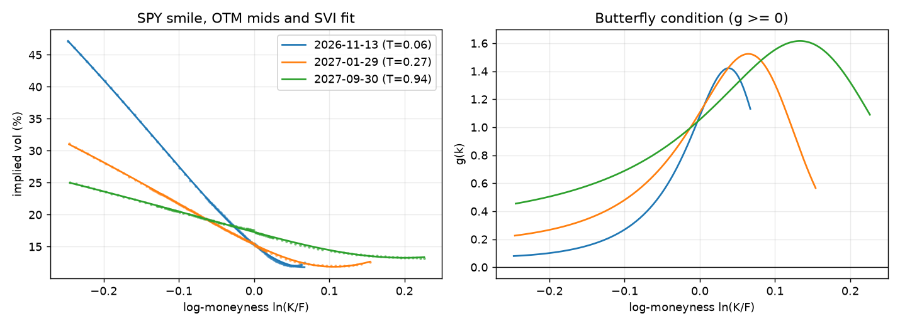
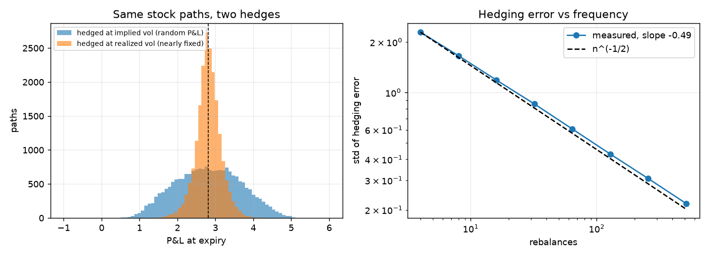
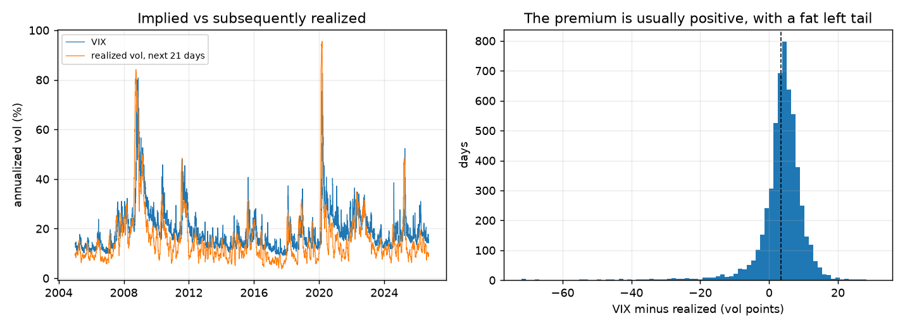

# options-pricer

[](https://github.com/neelayyagar1/options-pricer/actions/workflows/ci.yml)

A Python package for pricing options and for testing where the pricing model breaks on real market data. It prices options with the Black-Scholes-Merton closed form, Monte Carlo simulation and a binomial tree. The closed form is the reference, and the Monte Carlo engine is checked against it, so any disagreement shows up as a failing test instead of a plausible-looking number. The second half applies the model to a live option chain and to index history.

What is covered:

- European options by closed form, with all five Greeks derived analytically
- European, Asian (arithmetic and geometric) and barrier options by Monte Carlo
- American options by Longstaff-Schwartz least squares Monte Carlo, checked against a binomial tree
- Variance reduction (antithetic variates, control variates), with the reduction measured
- Greeks from the simulation two ways (finite difference and pathwise), compared with the analytic values
- Implied forward and implied volatility from a real SPY option chain, and an SVI fit of the smile with no-arbitrage checks
- A delta-hedging simulator that shows what the constant-volatility assumption costs when you actually hedge
- A variance risk premium study (VIX against realized S&P 500 volatility) and a walk-forward realized volatility forecast

Everything is seeded, the market data is committed as snapshots, and the figures below regenerate offline with `python examples/run_all.py`.

## The idea in plain language

**What is an option worth?** A call pays `max(S_T - K, 0)` at expiry. The hard part is that nobody knows `S_T`, so the question is how to put a fair price today on a payoff that depends on a random future price.

**Why risk-neutral pricing works.** Suppose you sell the option and hold some shares of the stock against it. If you adjust the number of shares continuously, the random part of the option and the random part of the shares cancel, and what is left has no risk. A position with no risk has to earn the risk-free rate, or someone could borrow cheaply and lock in free profit. That requirement pins down the price. Notice what it never used: how much the stock is expected to grow, or how much anyone dislikes risk. Both drop out. So we are free to compute the price in a simplified world where every asset grows at the risk-free rate on average. This does not claim investors are indifferent to risk. It is a calculation device that gives the same price as the no-arbitrage argument.

**The PDE.** Writing the argument above in math gives the Black-Scholes equation for the option value $V(S, t)$:

$$\frac{\partial V}{\partial t} + \frac{1}{2}\sigma^2 S^2 \frac{\partial^2 V}{\partial S^2} + (r - q) S \frac{\partial V}{\partial S} - rV = 0$$

Read it as bookkeeping for the hedged position: time decay, the cost of curvature in the payoff, and the carry on the hedge have to add up to the risk-free return. For a call it has the closed-form solution

$$C = S e^{-qT} N(d_1) - K e^{-rT} N(d_2), \qquad d_{1,2} = \frac{\ln(S/K) + (r - q \pm \tfrac{1}{2}\sigma^2)T}{\sigma\sqrt{T}}$$

**Monte Carlo is the same price computed by brute force.** Under the risk-neutral measure the price is the discounted expected payoff:

$$V_0 = e^{-rT}\,\mathbb{E}^{\mathbb{Q}}[\text{payoff}]$$

So simulate many possible futures where the stock grows at $r - q$ on average, compute the payoff in each, average, and discount. By the law of large numbers the average converges to the price. The cost is speed: the error shrinks like $1/\sqrt{N}$, so one extra digit of accuracy takes 100 times more paths. That is the reason for variance reduction, and the reason every price from this package comes with a standard error.

## Methods

**Path simulation.** Under the model the log price is exactly normal, so each step is sampled from the exact transition and there is no Euler discretization error:

$$S_{t+\Delta t} = S_t \exp\left[(r - q - \tfrac{1}{2}\sigma^2)\Delta t + \sigma\sqrt{\Delta t}\, Z\right]$$

Any remaining bias in an Asian or barrier price comes from where the contract is observed, not from the price process. Simulation runs in chunks, so memory stays bounded for large path counts.

**Standard errors.** With antithetic variates the $2N$ payoffs are not independent, so the standard error is computed from the $N$ pair averages. Using the raw payoffs understates the error when the technique hurts and overstates it when it helps.

**Control variates.** An arithmetic Asian call is priced using the geometric Asian call, which has a closed form. The monitoring is discrete in the simulation, so the closed form has to be the discrete one. With dates $t_i = i\Delta$ for $i = 1, \dots, n$:

$$\mu_G = \ln S_0 + \left(r - q - \tfrac{1}{2}\sigma^2\right)\frac{(n+1)\Delta}{2}, \qquad \sigma_G^2 = \frac{\sigma^2 \Delta (n+1)(2n+1)}{6n}$$

The variance uses $\sum_{i,j}\min(i,j) = n(n+1)(2n+1)/6$. Using the continuous Kemna-Vorst formula instead would subtract a variable whose assumed mean is not its simulated mean, and bias the price. The control coefficient is estimated on a separate pilot run.

**Barrier options.** Checking a barrier only at the simulation dates misses crossings between dates, so knock-outs come out too expensive. The package weights each path by the probability that a Brownian bridge between consecutive points stayed away from the barrier $B$:

$$p_i = \exp\left[-\frac{2\ln(B/S_i)\ln(B/S_{i+1})}{\sigma^2\Delta t}\right]$$

This prices a continuously monitored barrier. For a contract that really is monitored at fixed dates, switch it off (`bridge=False`) and simulate on those dates.

**American options.** Longstaff-Schwartz goes backward from expiry. At each exercise date it regresses the discounted cashflow the holder goes on to receive on the current spot, using in-the-money paths only, and exercises when intrinsic value beats the fitted continuation value. The regression is a scikit-learn `Pipeline` (polynomial features into linear regression), and any estimator with `fit` and `predict` can be passed in. The policy is fitted on one set of paths and valued on a second independent set. Valuing on the same paths used for fitting lets the regression see the outcomes it predicts and biases the price up. The two-pass estimate is a lower bound. A CRR binomial tree provides the independent check.

**Greeks.** Finite difference bumps an input and reprices. It only works with common random numbers (the same normal draws in every bumped run), otherwise the noise in each price swamps the difference. Pathwise differentiates the payoff inside the expectation. It has lower variance and needs one simulation, but it needs a payoff that is continuous in the parameter. For a digital it returns zero (there is a test for this), and it cannot give gamma for a vanilla because the payoff has a kink and no second derivative. Likelihood ratio is the usual fix for both.

**Implied forward.** Put-call parity says $C(K) - P(K) = D\,(F - K)$ for European options, so the quotes themselves give the forward $F$ and discount factor $D$. Fitting both from a narrow strike range turned out to be unreliable (the slope gave implied rates of -50% on short expiries). So the discount factor is fixed from the 13-week T-bill rate, and the forward is the average of $K + (C - P)/D$ over liquid strikes, which is stable. The free regression is kept as a diagnostic and is exact on clean European quotes.

**Implied volatility.** Newton-Raphson with the analytic vega, falling back to Brent's method when vega is near zero (deep out-of-the-money). Prices outside the no-arbitrage bounds are rejected. The smile uses out-of-the-money mids only (calls above the forward, puts below), after filtering on bid-ask spread.

**SVI smile.** Total implied variance $w = \sigma^2 T$ against log-moneyness $k = \ln(K/F)$ is fitted per expiry with raw SVI:

$$w(k) = a + b\left[\rho (k - m) + \sqrt{(k - m)^2 + s^2}\right]$$

The fit is non-convex, so it uses several starting points. Two static no-arbitrage conditions are then checked rather than assumed: the butterfly condition (Gatheral's $g(k) \ge 0$, which keeps the implied density positive) and the calendar condition (total variance non-decreasing in maturity).

**Delta hedging.** Sell an option at implied vol $\sigma_i$ and hedge discretely while the stock moves with realized vol $\sigma_r$. Hedging with the delta at implied vol gives a random P&L whose continuous-time form is

$$\text{P\&L} = \int_0^T e^{r(T-t)}\,\tfrac{1}{2} S_t^2\,\Gamma_t\,\left(\sigma_i^2 - \sigma_r^2\right) dt$$

with $\Gamma$ evaluated at implied vol. Hedging with delta at realized vol gives a deterministic total, $\left(\text{BS}(\sigma_i) - \text{BS}(\sigma_r)\right)e^{rT}$, but a bumpy path. With a finite number of rebalances there is also hedging error whose standard deviation falls like $n^{-1/2}$. The tests check the integral formula path by path.

**Variance risk premium.** The VIX is the market's 30 day implied variance. At each date it is compared with the realized variance over the following 21 trading days. Windows overlap, so ordinary standard errors would be far too small. The study reports Newey-West errors, and a second estimate using only non-overlapping windows. The VIX is variance-swap-like and includes the whole skew, so it is not an at-the-money Black-Scholes volatility. Both the volatility premium (VIX minus realized) and the variance premium (squared) are reported, since both appear in the literature.

**Volatility forecast.** A scikit-learn ridge model forecasts the log of the next 21 days of realized volatility from HAR-style features (backward realized volatility over 1, 5 and 22 days), with and without the VIX. Validation is walk-forward with `TimeSeriesSplit` and a 21 day gap between train and test, because the target looks 21 days ahead and without the gap the last training labels overlap the first test window.

## Results

All Monte Carlo, Greeks and hedging numbers use an assumed market ($S_0 = 100$, $\sigma = 20\%$, $r = 4\%$, $q = 1.5\%$, $T = 1$ unless the table says otherwise). The smile uses the committed SPY option chain snapshot, and the premium study uses the committed VIX and S&P 500 history. Everything below is regenerated by `examples/run_all.py`.


Pseudo-random Monte Carlo converges at the expected rate of about $N^{-1/2}$. The Sobol arm is faster, but only for this one-dimensional problem (a European payoff depends on a single normal draw). Sobol points are not independent, so there is no valid standard error for that arm, and the benefit fades as the number of time steps grows unless the paths are built with a Brownian bridge or PCA. It is used here as a benchmark only.


The geometric control variate removes almost all the variance of the arithmetic Asian price (correlation about 0.9996). Antithetic variates help a little for monotone payoffs like a call, and can make things worse for a payoff symmetric about the forward, such as a straddle. The speedup column includes runtime and depends on the machine.




The smile is the main place the model is wrong. Black-Scholes says every strike should have the same implied vol, a flat line. The market puts a steep skew on equity index options: out-of-the-money puts are priced at much higher vols than calls, and the skew is steepest at short expiries. The SVI fits match the quotes to about 0.1 vol points on most expiries, and the fitted surface passes both no-arbitrage checks. Two expiries fit worse and are shown in the table. The snapshot is SPY, which has American-style options, so parity is only approximate, and the quotes are Friday's close. Only the forward is taken from parity. The implied dividend yield it would give drifts with maturity, which I read as a sign of the American early-exercise premium and quote timing, so it is not used.



Hedging at the volatility you sold at leaves a random P&L, and hedging at the volatility that actually happens makes the total nearly certain. Both have the same average here. The right panel is the cost of discrete hedging: the spread of the error shrinks as $n^{-1/2}$, so it never reaches zero.



The volatility premium is large and statistically clear: the VIX sits above subsequently realized volatility on about 84% of days. The variance premium is much weaker once overlap is handled, because the average is pulled down by a few crises where realized volatility far exceeded the VIX. That is the point of the premium: it pays for carrying that tail, and it is not a free edge. The forecast gap table is a negative result. The difference between the VIX and the model forecast does not pick out days with a larger premium. The model improves the forecast of realized volatility on log RMSE, but the VIX is better on QLIKE, which punishes under-forecasts during spikes more heavily.

<!-- results:start -->

#### Convergence (ATM call, 40 replications per N)

| Source | Fitted slope |
|---|---|
| Pseudo-random | -0.514 |
| Sobol (1-D) | -1.046 |

#### Variance reduction (equal path count, 400k paths)

| Contract | Method | Price | Std error | Variance reduction | Cost-adjusted speedup |
|---|---|---|---|---|---|
| Vanilla call | plain | 8.9920 | 0.02167 | 1.0x | 1.0x |
| Vanilla call | antithetic | 9.0041 | 0.01631 | 1.8x | 2.9x |
| Arithmetic Asian call | plain | 5.1653 | 0.01211 | 1.0x | 1.0x |
| Arithmetic Asian call | antithetic | 5.1568 | 0.00894 | 1.8x | 1.6x |
| Arithmetic Asian call | control variate (geometric) | 5.1695 | 0.00032 | 1398.5x | 1229.4x |

Pilot correlation between arithmetic and geometric Asian: 0.9996

#### Up-and-out call, barrier 125 (continuous monitoring)

| Steps | Grid only | Bridge |
|---|---|---|
| 5 | 3.1583 | 2.0401 |
| 10 | 2.8738 | 2.0399 |
| 20 | 2.6547 | 2.0369 |
| 50 | 2.4510 | 2.0491 |
| 100 | 2.3226 | 2.0406 |
| 250 | 2.2497 | 2.0608 |
| 500 | 2.1835 | 2.0494 |

#### Greeks, call K=105 (1M paths, common random numbers)

| Greek | Analytic | Finite difference | Pathwise |
|---|---|---|---|
| Delta | 0.4851 | 0.4838 | 0.4847 |
| Gamma | 0.0196 | 0.0197 | n/a |
| Vega | 39.2932 | 39.1900 | 39.1572 |
| Theta (per year) | -4.8696 | -4.8570 | n/a |
| Rho | 41.6994 | 41.5955 | 41.6823 |

#### American put, S=100, sigma=30%, r=5%, T=1 (LSM, 200k paths, 50 dates)

| Strike | LSM | Std error | Binomial (2000 steps) | European |
|---|---|---|---|---|
| 90 | 5.5595 | 0.0188 | 5.5521 | 5.3081 |
| 100 | 9.8927 | 0.0247 | 9.8704 | 9.3542 |
| 110 | 15.6076 | 0.0295 | 15.6182 | 14.6553 |

#### SVI fits, SPY on 2026-10-23 (spot 759.97)

| Expiry | T (years) | Points | Fit RMSE (vol pts) | Min g(k) | Vol at k=-0.10 minus vol at k=+0.10 (pts) |
|---|---|---|---|---|---|
| 2026-11-13 | 0.058 | 123 | 0.14 | 0.080 | 15.0 |
| 2026-11-20 | 0.077 | 144 | 0.15 | 0.105 | 13.4 |
| 2026-11-27 | 0.096 | 112 | 0.13 | 0.118 | 12.7 |
| 2026-11-30 | 0.104 | 230 | 0.13 | 0.120 | 12.3 |
| 2026-12-04 | 0.115 | 113 | 0.12 | 0.138 | 11.9 |
| 2026-12-18 | 0.153 | 156 | 0.08 | 0.179 | 11.2 |
| 2026-12-31 | 0.189 | 270 | 0.08 | 0.188 | 10.7 |
| 2027-01-15 | 0.230 | 60 | 0.06 | 0.204 | 10.1 |
| 2027-01-29 | 0.268 | 149 | 0.07 | 0.226 | 9.8 |
| 2027-02-19 | 0.326 | 63 | 0.06 | 0.245 | 9.1 |
| 2027-02-26 | 0.345 | 139 | 0.06 | 0.256 | 9.0 |
| 2027-03-19 | 0.403 | 69 | 0.05 | 0.282 | 8.4 |
| 2027-03-31 | 0.436 | 133 | 0.57 | 0.256 | 7.9 |
| 2027-06-17 | 0.649 | 76 | 0.07 | 0.377 | 7.1 |
| 2027-06-30 | 0.685 | 142 | 0.28 | 0.403 | 7.2 |
| 2027-09-17 | 0.901 | 75 | 0.09 | 0.449 | 6.3 |
| 2027-09-30 | 0.937 | 139 | 0.09 | 0.454 | 6.0 |

Calendar arbitrage violations between adjacent slices: 0

#### Delta hedging a short ATM call

Sold at 25% vol, stock realizes 15%, 126 rebalances, 20k paths.

| Hedge volatility | Mean P&L | Std of P&L |
|---|---|---|
| Implied (25%) | 2.815 | 0.856 |
| Realized (15%) | 2.816 | 0.323 |

Deterministic limit when hedging at realized vol: 2.812

#### Variance risk premium, VIX vs realized S&P 500 vol (2005-01-03 to 2026-09-24)

Realized vol is measured over the 21 trading days after each date.

| Measure | Mean | Newey-West t | Non-overlapping t | Share of days positive |
|---|---|---|---|---|
| Volatility premium (VIX - RV, vol points) | 3.47 | 8.7 | 7.5 (n=261) | 84% |
| Variance premium (VIX^2 - RV^2, vol points squared) | 76.43 | 2.3 | 1.7 (n=261) | 84% |

Mean VIX 19.1, mean realized 15.6. Date with the most negative premium (a seller's worst case): 2020-02-20 (-72.0 vol points).

#### Walk-forward forecast of 21-day realized vol

Out of sample 2008-02-06 to 2026-09-24, scikit-learn ridge with an expanding window and a 21 day gap between train and test.

| Forecast | RMSE of log vol | QLIKE | Mean log error |
|---|---|---|---|
| VIX as the forecast | 0.452 | 0.378 | +0.282 |
| HAR (ridge) | 0.403 | 0.509 | -0.016 |
| HAR + VIX (ridge) | 0.357 | 0.415 | +0.029 |

#### Does the gap between the VIX and the model forecast predict the premium?

| Gap quintile (1 = smallest) | Days | Mean realized vol premium (vol pts) |
|---|---|---|
| 1 | 938 | 4.04 |
| 2 | 937 | 3.95 |
| 3 | 938 | 3.70 |
| 4 | 937 | 3.34 |
| 5 | 938 | 2.98 |

Correlation between the gap and the realized premium: -0.058.

<!-- results:end -->

## Assumptions and limitations

- **Constant volatility.** The smile above shows this is the main way the model is wrong. The delta-hedging results are sensitive to it too.
- **Lognormal returns, no jumps.** Crashes are much more likely in real markets than the model allows.
- **Continuous trading, no transaction costs.** The hedging argument needs continuous rebalancing, and real hedging has costs that the simulator does not include.
- **Constant rate and continuous dividend yield.** Real dividends are discrete, and rates have a term structure. The market data layer uses one T-bill rate for all expiries.
- **American options use a finite set of exercise dates.** The result is a Bermudan approximation that approaches the American price as the dates get denser, and it is a lower bound.
- **SPY options are American.** The smile treats them as European using out-of-the-money quotes, which carry little early-exercise value, but it is an approximation. `^SPX` options are European, but yfinance returns no bid or ask for them outside trading hours.
- **One day of option data.** yfinance only serves current option chains, so there is no history of smiles. The premium study uses the VIX because that history exists.
- **The premium is a risk premium, not an edge.** The VIX cannot be traded directly, there are no costs in the study, and the sample holds only a handful of crash episodes (2008, 2020), so the tail is poorly measured.

## Install and run

```bash
python -m venv .venv && source .venv/bin/activate
pip install -e ".[dev]"
pytest
ruff check . && ruff format --check . && mypy
python examples/run_all.py
```

To refresh the committed market data (needs network):

```bash
python examples/refresh_data.py SPY
```

Quick example:

```python
from pricer.instruments import EuropeanOption, OptionType
from pricer.market import MarketParams
from pricer.monte_carlo import simulate_european
from pricer import black_scholes as bs

market = MarketParams(spot=100, volatility=0.20, rate=0.04, dividend_yield=0.015)
call = EuropeanOption(strike=100, maturity=1.0, option_type=OptionType.CALL)

exact = bs.price_contract(call, market)
mc = simulate_european(market, call, n_paths=1_000_000, seed=1, antithetic=True)
print(exact, mc.price, mc.confidence_interval())
```

## Layout

```
src/pricer/
  black_scholes.py       closed form and analytic Greeks
  analytic.py            discrete geometric Asian closed form
  paths.py               GBM paths, antithetic and Sobol draws
  payoffs.py             vanilla, Asian, barrier payoffs
  estimators.py          MCResult, standard errors, running moments
  monte_carlo.py         chunked simulation engine
  variance_reduction.py  control variate estimator
  american.py            Longstaff-Schwartz (scikit-learn regression)
  binomial.py            CRR tree
  greeks.py              finite difference and pathwise Greeks
  convergence.py         convergence rate measurement
  forward.py             implied forward from put-call parity
  implied_vol.py         implied vol solver and smile extraction
  surface.py             SVI fit and arbitrage checks
  hedging.py             delta-hedging simulator
  vrp.py                 variance risk premium and inference
  forecast.py            walk-forward volatility forecast (scikit-learn)
  data/
    loader.py            option chain loader (yfinance) and snapshots
    history.py           VIX and S&P 500 history and snapshot
    snapshots/           committed data
tests/                   pytest suite, all seeded
examples/run_all.py      regenerates figures, results.md and the results block above
examples/refresh_data.py updates the committed snapshots
```

Paths and payoffs are kept apart on purpose. `paths.py` produces arrays of shape `(n_paths, n_steps + 1)` and a payoff is a plain function of that array, so a new contract does not touch the simulator.

## Testing

The tests check properties as well as values:

- put-call parity for prices and for every Greek
- the analytic Greeks against numerical derivatives of the price
- exact limits at $T = 0$ and $\sigma = 0$ (no `nan`)
- Monte Carlo within three standard errors of Black-Scholes, and a measured convergence slope near $-1/2$ using RMSE over independent replications
- the antithetic standard error against a brute-force replication study
- the discrete geometric Asian formula against simulation, and in the limit against Kemna-Vorst
- barrier in-out parity, step-count stability of the bridge correction, and a check against the Broadie-Glasserman-Kou barrier shift
- American call with no dividends equal to the European call, and Longstaff-Schwartz against the binomial tree
- pathwise Greeks against analytic, and the digital payoff where pathwise fails
- implied vol round trips, rejection of arbitrage-violating prices, and recovery of a known smile from a synthetic chain
- the free parity regression recovering the rate on clean quotes, and being unstable under noise
- SVI recovery of known parameters, and detection of butterfly and calendar violations
- the delta-hedging P&L matching the gamma integral path by path, deterministic P&L at realized vol, and the $n^{-1/2}$ error slope
- Newey-West errors against brute force on overlapping data, and no overlap between train and test in the walk-forward split

## Roadmap

- Refresh the smile on a trading day, and with `^SPX` (European) quotes
- Fit SVI jointly across expiries with an arbitrage-free constraint
- Hedge on the fitted surface instead of a flat volatility
- Likelihood ratio Greeks, and an upper bound for American options
- Heston stochastic volatility

## References

- Black and Scholes (1973), Merton (1973)
- Longstaff and Schwartz (2001), Valuing American Options by Simulation
- Broadie, Glasserman and Kou (1997), A Continuity Correction for Discrete Barrier Options
- Gatheral and Jacquier (2014), Arbitrage-free SVI volatility surfaces
- Boyle and Emanuel (1980), Discretely adjusted option hedges
- Corsi (2009), A simple approximate long-memory model of realized volatility
- Glasserman (2003), Monte Carlo Methods in Financial Engineering
- Hull, Options, Futures, and Other Derivatives
